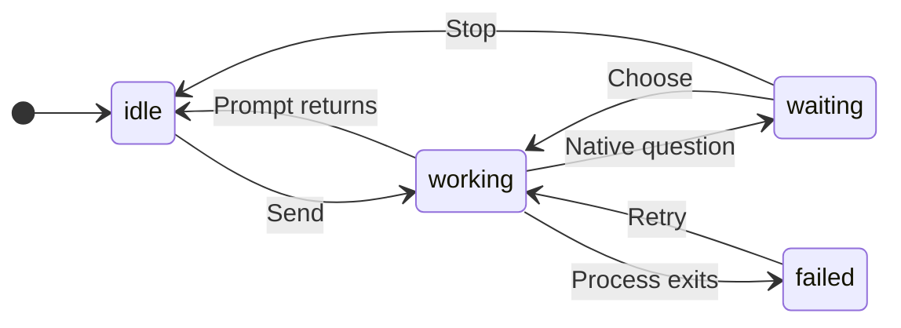
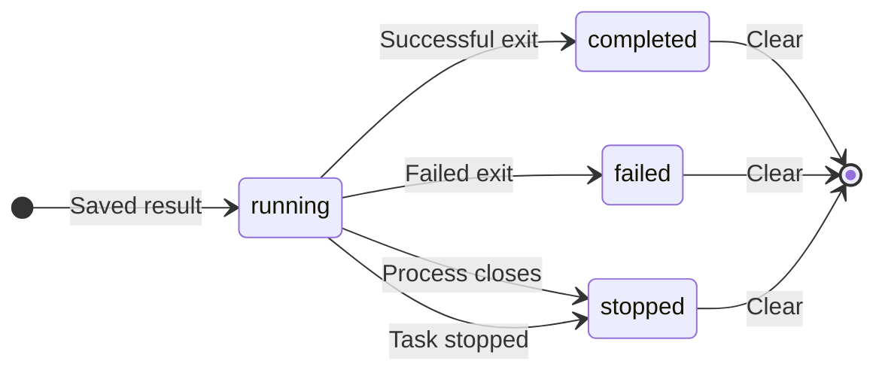

# UX: Read Claude through its ordinary terminal and transcript

## 1. Why

Alex wants the tmux plugin to submit messages and read replies without telling Claude that GeckIt is managing the conversation. Remove the plugin's HTTP hooks and appended system instructions. Preserve native permissions and subscription authentication. Existing conversation history and user-authored instructions can still reveal automation; the transport cannot promise undetectability.

## 2. Affected surfaces

| Surface | Behavior | When visible |
| --- | --- | --- |
| Existing transcript | Replies arrive when Claude appends its JSONL file | Claude produces a message |
| Existing question card | Claude's native terminal question and choices | A native numbered selection needs input |
| Existing board status | Working, waiting for an answer, finished or failed | The terminal changes state |
| Existing Stop button | Sends Ctrl+C to the native terminal | User presses Stop |

No new UI components or styling. Native choices use the existing question card rather than pretending that GeckIt's former permission grants still apply.

## 3. States

| State | Trigger | Visible result | User action |
| --- | --- | --- | --- |
| Working | Message submitted or terminal shows work | "Working - sending to Claude Code", then "Working - waiting for Claude Code" and appended reply/tool items | Wait or Stop |
| Waiting | Terminal displays a selectable numbered question | Native question and exact choice labels | Choose an option |
| Finished | Recognized idle input prompt after observed turn activity | Last answer; existing finished notification | Read or send a follow-up |
| Stopped | Ctrl+C followed by native idle state | Existing "Stopped" state | Send another message |
| Failed | Claude process exits during a turn or submission fails | Existing failure with concrete detail | Retry |

## 4. Transitions

| From | Event | To | Visible result |
| --- | --- | --- | --- |
| Idle | User sends a message | Working | "Working" |
| Working | Poll detects a native selection, automatically | Waiting | Native title and exact choices |
| Waiting | User chooses a currently displayed option | Working | Card folds; native keyboard selection |
| Waiting | Native selection changes outside GeckIt, automatically | Waiting/Working | Old card resolves; new card if needed |
| Working | Idle input prompt returns after turn activity, automatically | Idle | Existing finished state |
| Working/Waiting | User presses Stop and terminal returns to idle | Idle | "Stopped" |
| Working | tmux pane/process disappears, automatically | Failed | "Claude Code exited." |

## 5. Quiet states

Polling, file offsets and terminal inspection produce no user messages. Unknown terminal layouts remain working: elapsed silence alone never means completion. No hook endpoint, bearer token or app-specific system prompt is given to Claude.

## 6. Timing

| Threshold | Value | Reason |
| --- | --- | --- |
| Typing interval | Random 15-45 ms per character | Preserve ordinary typing for short input |
| Paste threshold | More than 80 Unicode characters | Bound per-character delays for longer messages |
| Typed prefix for long input | 12 Unicode characters | Begin with ordinary typing, then paste the remainder without splitting a Unicode character |
| Paste settling | 100 ms before submit/navigation | Let native bracketed-paste handling finish before the next key |
| Poll interval | 500 ms | Preserve existing transcript cadence without per-token reads |
| Idle confirmation | Two consecutive polls after observed activity | Avoid a transient prompt during redraw or submission |
| Process check | Every four polls | Detect missing sessions and retained dead panes |
| Idle shutdown | One hour after a finished turn | Keep the terminal available for follow-ups; new sends reset the timer, working/approval/background states prevent shutdown |

## 7. Wording

Question title and choices are Claude's native terminal text. Existing app labels remain "Working", "Stopped", and "Claude Code exited.". No new labels that imply guaranteed invisibility.

## 8. Edge cases

- Resume: begin at the old transcript's end; do not replay old answers.
- Multiline text: typed line breaks use backslash followed by Enter; pasted line breaks stay inside one bracketed paste. Enter submits the complete prompt once.
- Incomplete JSONL line: retain bytes until its newline arrives.
- Long-running tool or hook: retain Working while native busy indicators remain.
- Fast answer: new transcript data provides turn activity even if no busy screen was sampled.
- Stale question: recapture before answering; never select an option from an obsolete screen.
- Answer review: Claude's "Review your answers" screen can end with "Ready to submit your answers?", "Submit answers" and "Cancel" without a navigation footer. Show its existing question card with the review and exact choices. Choosing Submit answers sends Enter to the selected native option; choosing Cancel returns to the native question flow. Neither action happens automatically. A quoted review in a reply followed by an idle prompt is not a question.
- Native workspace trust: recognize the exact trust prompt, move to Yes, wait 700 ms for native input to settle, and recapture the screen to confirm Yes is visibly selected before pressing Enter. If startup ignores the navigation key, retry without submitting No, exit.
- Images: preserve temporary image paths and remove files after completion/stop.
- Existing GECKIT.md: exclude only that file per session if verified supported; do not edit shared global instructions.
- Existing conversation: prior messages/system context may already mention GeckIt.
- Synthetic records: No response requested and other non-error placeholders never cause Failed. Only explicitly flagged API errors cause failure; a subsequent real assistant response clears an error after recovery.

## 9. Deliberate omissions

No permission bypass, authentication changes, global setting edits, fabricated tool requests or guaranteed undetectability. No token-level streaming: Claude's saved message blocks are the reply source.

## 10. Decisions

Use tmux input, native terminal selection and passive JSONL reading. Remove HTTP hooks. Completion requires the actual input prompt and turn activity, not a silence timeout. User hooks remain active. Per-session GECKIT.md exclusion avoids changing builtin Claude sessions.

## 11. Acceptance

- Launch arguments contain no GeckIt hooks or appended system prompt.
- First and subsequent multiline prompts reach ordinary Claude input.
- Replies and tool entries reach GeckIt from JSONL.
- Native choices, Stop, resume, trust and image cleanup have focused regression coverage.
- Verification records any unavailable native app review.

## 12. Verification

- Node syntax checks and all three focused tests pass. Integration covers multiline first/follow-up input, no hooks or source prompt, environment filtering, resume offset, working silence, idle-before-activity, unknown layout, native denial and stale choices, custom answers, partial UTF-8 JSONL, local slash commands, image cleanup, explicit trust selection after an ignored startup key, Stop and process exit.
- Native Claude Code 2.1.294 passed an end-to-end driver test: trust confirmation, PONG from JSONL, idle completion, follow-up Red/Blue question, selecting Blue and completion. Its idle prompt, working spinner without interrupt hints and numbered question match the parser. Native `/memory` comparison shows GECKIT.md in the baseline session and absent with per-process exclusion; other user/project instructions remain.
- GeckIt Local computer access was denied by Computer Use. Full-window light/dark, keyboard/focus, scrolling and viewport review of its existing question cards is unavailable. No frontend components or styles changed.
- Unknown layouts stay working rather than reporting completion; native dialogs outside numbered menus require terminal interaction.

## 13. Rollout

October 13 answer-review regression: the active Claude 2.1.296 pane stopped at a footerless Submit/Cancel menu. The old parser classified it as Unknown. A fixture reproduces the review layout, including selected answers, both focus positions and a quoted review followed by an idle prompt. Real tmux with fake Claude verifies that review waits for an explicit choice, rejects message injection while waiting, and sends Submit or Cancel to the native menu. The suite passes 19 of 20 tests; the existing ignored-trust-navigation assertion also fails on unchanged provider code. Syntax checks and the bundle build pass. No renderer components or styles changed. Browser inventory failed to load its request-header policy, and automatic Computer Use review denied GeckIt Local access; full-window light/dark and responsive question-card review remain unavailable.

Install or update the library through Settings > Libraries. Apply update loads the new provider without restarting GeckIt; existing active turns finish with their current driver. Later sends adopt the replacement provider. The driver remains open for one hour after a completed turn, with new messages resetting the idle timer.

### Plan-limit refresh

The first limits request reads `/usage` to initialize the existing usage display. Later requests read `/usage` only after a message was successfully submitted through this provider since the previous check began, and the randomized 15-30 minute cooldown has elapsed. Ordinary sends and Send now deliveries count after the terminal accepts Enter. Queued, rejected or failed sends do not count. Messages submitted during a check remain eligible for the next check. A failed check retains cached limits and requires another message before a later attempt.

Without new messages, polling returns remembered limits without terminal interaction, even after the cooldown. Remembered reset times still roll forward locally. Transcript limit events update remembered values without scheduling a check. These transitions are silent; the existing usage display, wording and layout remain unchanged. This replaces elapsed-time-only refreshes to avoid repeated checks while the provider is unused.

Regression coverage uses fake Claude in an isolated real tmux server: initial read, no-message polling after the cooldown, sent-message refresh, retained messages during a check, concurrent requests, local reset rollover, transcript limit updates, failed checks, failed startup, ordinary sends and accepted/rejected injections. No frontend files or styles change; native visual review is not part of this terminal-only fix.

### Diagnostic audit

The host logger records `usage.command.sent` after `/usage` is submitted, and check-start/outcome/skip events with IDs, new-message counts and next allowed check time. Session/turn events and successful-send counts include no conversation content. Missing logging on an older host remains silent and does not change execution. See GeckIt's `docs/ux/plugin-logs.md` for shared file storage and inspection behavior.

## 14. Synthetic-message regression

The resumed native probe transcript wrote No response requested with isApiErrorMessage false immediately before a user's Hi and a normal assistant reply. The first passive driver incorrectly classified every synthetic record as a failure. Failure detection now requires isApiErrorMessage true. A later real assistant response clears an error after recovery. All three tests pass, including benign synthetic, flagged API error and recovered error cases. The regression is covered by the integration test.

## 15. Passive background tasks

The tmux driver reads background task starts from saved tool results, including `backgroundTaskId` for commands and `isAsync` with `agentId` for helpers. It emits the existing task signals so GeckIt's card and Background dialog show work after the reply ends. Output paths come from the result or Claude's per-project, per-session task folder. No prompts, hooks, `/tasks` submissions or extra model requests are added.

| Surface | Visible result | When visible |
| --- | --- | --- |
| Existing card | "A command running" or the existing helper state | A tracked background task runs |
| Existing Background dialog | "Running", "Finished", "Failed" or "Stopped" with command/output details | A task is discovered |
| Existing task output | "Nothing printed yet." | A running task's file is empty |

| State | Trigger | User action |
| --- | --- | --- |
| Running | A saved result identifies background work | Read its output or continue chatting |
| Finished | Exit code 0 or a completion notice | Read or clear the task |
| Failed | Nonzero exit code or a failure notice | Read output, then decide next step |
| Stopped | A stop notice, successful TaskStop result, final `[killed]` output marker or the owning Claude process closes | Read or clear the task |

| From | Event | To | Visible result |
| --- | --- | --- | --- |
| Unlisted | Poll reads a background result, automatically | Running | Task appears in Background |
| Running | Poll reads an exit marker or notice, automatically | Finished/Failed/Stopped | Task stays listed with its final state |
| Running | Claude's owning process closes, automatically | Stopped | Running indicator ends |
| Running | Poll reads a successful TaskStop result or final `[killed]` marker, automatically | Stopped | Running indicator ends; task remains available to read or clear |
| Finished/Failed/Stopped | User presses Clear | Unlisted | Task disappears and is not emitted again on unchanged polls |
| Saved history | A new Claude process resumes, automatically | Finished/Failed/Stopped | Old tasks retain final states; unresolved old tasks are stopped |

Polling uses the existing 500 ms cadence. Each running command reads at most the last 512 bytes of output, enough for the exit marker without loading large logs. Empty, missing or silent output never means completion. A helper's output is a transcript; completion comes from task notices, not a guessed period of silence. Completed task output paths remain available to the host reader.

A TaskStop request alone does not end a task. Its matching successful tool result must identify the tracked task. Failed stops leave the task running. A `[killed]` marker must occupy the final output line. Repeated stop records and later polls preserve the first final state and do not emit duplicates.

A terminal footer count alone has no task ID or command, so it does not create invented tasks or decide which task ended. Historical "shell still running" summary lines are not authoritative. Local `!` background launches are tracked when Claude saves an ID; detached jobs with no Claude task record remain outside this list. Native Stop controls still belong to Claude's terminal; this change adds discovery and status, not a terminal task-control protocol.

No polling messages or file errors appear in chat. Partial JSONL records wait for the newline. Repeated records emit only changed task state. Old replies are not replayed when task history is reconstructed. Closing a foreground turn does not stop background tasks, and known running tasks keep the driver available under the host's existing idle rules.

Verification covers saved starts, helpers, notifications, partial records, empty/missing output, successful/failed exit markers, repeated polls, resumed history and process closure using fake Claude in isolated tmux. Full-window visual verification is recorded separately; shared task components, tokens and layout are unchanged.

Native verification read the active Claude 2.1.296 session transcript and task output files without sending terminal input: the tracker distinguished completed commands from the currently running command. Computer Use denied access to GeckIt Local. Full-window light/dark, focus/keyboard, scrolling and desktop/phone viewport review could not be performed. No shared renderer component or style changed. Performance checklist scope is unchanged; stable polls emit no task updates, and output reads are bounded.

October 12 stop regression: the native `bint88s11` transcript records a successful TaskStop at 17:55:21.449 UTC; its output ends with `[killed]` and no exit-code marker. Replaying the transcript and polling the output independently both produce Stopped. Nine tracker tests and the fake-Claude driver integration pass. The complete provider suite passes 17 of 18 tests; the trust-navigation assertion at `test/tmux.test.mjs:265` also fails on the unchanged provider.

The real Background component and styles were reviewed in an isolated Chrome harness at 1352x676 and 390x844, in light and dark. The stopped command displays a fixed four-minute runtime. Enter opens its output, Left returns, X clears it and updates the finished count, and Escape restores focus to the opener. Tab gives Done a visible focus outline. A 28-task list scrolls to its helpers and Done button. Native output reading was replaced by a fixture in this harness; provider status transitions were verified separately with native replay and fake-Claude integration. The active GeckIt process was not restarted, so its loaded driver remains unverified with the new code.

### Hook rejection - 2026-10-14
When a UserPromptSubmit hook rejects a prompt, the driver reports Blocked by hook with Claude's diagnostic output. The host retains the rejected message and attachments and offers Try again. A terminal warning or JSON continuation rejection counts as activity even when no assistant response is written, so the turn settles through the existing two idle observations. Ordinary non-blocking Stop-hook errors do not end work. The next send clears the rejection; an old terminal warning cannot turn a later successful response into failure. Saved warnings replay as failure notes. This requires the matching GeckIt host change that handles the blocked end signal.

Verified with isolated fake-Claude terminal and JSON-hook rejection followed by successful work. Shared Chat was reviewed in Chrome in light/dark at 1352x676, 390x844 and 320x844; expanded reason, wrapping, scrolling, keyboard retry and preserved unrelated draft/photo passed. Provider calls were fixtures. The installed provider was not replaced or restarted. The full suite's pre-existing trust-navigation assertion also fails on unchanged HEAD.

### Native multiple-choice answers - 2026-10-15

The existing desktop and phone question card mirrors native checkbox labels and includes the native unnumbered "Submit" or "Next" action in its actual navigation position. Selecting a checkbox keeps the question open with its updated check mark; the person may toggle more choices and then press Submit/Next. This continues to Claude's existing answer review, where "Submit answers" remains explicit. Typing in "Something else" and pressing Enter fills the native inline input and advances to review/next question with the entered text selected. A "Type something" choice alone keeps the current card available for typing.

| From | Event | To | Visible result |
| --- | --- | --- | --- |
| Waiting | User clicks a checkbox | Waiting | Updated native check mark and Submit/Next action |
| Waiting | User enters custom text | Review/next question | Entered text retained alongside selected choices |
| Waiting | User presses Submit/Next | Review/next question | Claude's current review or next question |
| Review | User presses Submit answers | Working | Review resolves and Claude continues |
| Waiting/review | User presses Stop | Idle | Existing Stopped state |

Stale cards still recapture the native screen before sending input. Repeated clicks during answer delivery are ignored. Empty custom input is not submitted by the existing card. Single-choice menus and permission menus retain their native Enter behavior. Polling and navigation delays stay silent; no renderer layout, tokens or components change. Automatically accepting the final review is deliberately excluded because it belongs to the person's explicit choice. Acceptance requires real-tmux regression tests for toggles, Submit/Next focus and text, plus checking the installed native question without altering its answers.

Verification: all 28 provider tests passed with fake Claude on a private real-tmux server. A live read-only capture of Claude 2.1.300's blocked Schedule question confirms the checkbox and unnumbered Submit layout. The actual GeckIt Transcript component was exercised in Chrome at desktop width and 390-pixel content width, light and dark: checkbox selection, explicit Submit/review, custom input with Enter, final confirmation and keyboard focus passed against the isolated driver fixture. These checks do not verify model execution after a real account answer. Renderer and CSS are unchanged; the performance-review renderer checklist is outside this diff.

### Startup recovery - 2026-10-16

The existing send flow automatically relaunches Claude once if its tmux pane exits before any message text is typed. The original message and attachments stay in the same delivery operation. A saved native transcript resumes with the same conversation ID; a new conversation without a transcript keeps its original session/fork arguments. Existing conversations requested with resume never silently become empty conversations. Startup and recovery remain under the existing working indicator, with no extra notification or layout.

| From | Event | To | Visible result / action |
| --- | --- | --- | --- |
| Starting | Native pane exits before typing, automatically | Recovering | Existing working indicator; wait or Stop |
| Recovering | Replacement reaches the prompt, automatically | Sending | Existing "sending to Claude Code" status; wait or Stop |
| Recovering | Replacement exits, automatically | Failed | Existing failure card with native diagnostic; inspect and Try again |
| Starting/recovering | User presses Stop | Stopped | Existing stopped state; user can send again |
| Sending/working | Pane exits after typing begins, automatically | Failed | Existing failure and Try again; no automatic message replay |
| Failed | User presses Try again | Starting | Existing retry workflow |

Recovery is limited to one restart per send to avoid a permanent crash loop. There is no new delay; prompt readiness retains its existing 60-second bound per launch. A dead pane is retained long enough to capture its final terminal output, limited to the last 2,000 characters, then removed on recovery or closure. Error details appear only in the existing expandable diagnostic. Logs record recovery categories and session IDs, never terminal content.

Hook blocks, API errors, live question menus, slow startup and failures after typing begins do not trigger automatic recovery. Missing history is never treated as an empty replacement conversation. Cancellation is checked during readiness and typing so a stopped delivery cannot relaunch or submit later. The poller leaves startup failure handling to the send operation, preventing competing close and restart decisions. Resolved completed turns and queued-message delivery retain their current behavior. No renderer files, styling or shared UI contract change.

Requirements: reproduce startup exit with real tmux/fake Claude, recover the original message exactly once, bound repeated startup failures with a useful native diagnostic, resume saved history, honor cancellation, and verify submitted messages are never automatically replayed.

Verification: all 33 provider tests passed on isolated real tmux sockets with fake Claude after the startup-recovery implementation. The regression cases cover transient startup exit, bounded repeated exit with retained stderr, a vanished idle pane resuming the same ID, Stop during startup, and no replay after submission. A separate native Claude 2.1.301 startup probe, without sending any prompt, reproduced the reported conversation's permanent error: "No conversation found with session ID: c19beefb-91e9-4791-81a5-39516161b3b7". Its native transcript is absent in the current configuration. Automatic restart cannot reconstruct missing conversation history; the provider retains resume semantics and reports the diagnostic. The installed library and active conversations were not replaced or restarted. No renderer files changed, so no visual redesign or renderer-performance review applies.

### Long input delivery - 2026-10-16

First messages, follow-ups, Send now and custom answers use the same input rule. Up to 80 Unicode characters are typed as before. Longer text types its first 12 characters, loads the remaining text from stdin into a uniquely named tmux buffer, then pastes it with bracketed-paste mode. The system clipboard is untouched. Buffer cleanup runs on success, cancellation and transport failure. Existing readiness/cancellation checks run before loading, pasting and submitting. The driver waits 100 ms after pasting before Enter or native answer navigation; checkbox custom answers still defer Enter to the existing Submit/Next action.

The existing "sending to Claude Code" and "waiting for Claude Code" states and transitions remain. No threshold preference or paste notification is added because choosing transport needs no user action. A failed paste uses the existing failure path; Send now retains its queued message and clears partial input when the terminal is safe to clear. Stop prevents later paste/submission. Startup recovery never replays text after input has started. Acceptance: exact short/long boundaries, Unicode and multiline integrity, one submission, successful Send now, buffer cleanup on failure, and Stop before submission in isolated real tmux with fake Claude.

Verification: all 38 provider tests pass, including four input-delivery regressions on isolated real tmux with fake Claude. The boundary uses 80 emoji characters and 81 CJK characters; a multiline Unicode prompt over 12,000 characters arrives exactly once within the seven-second assertion. Long Send now and checkbox custom answers preserve exact content and explicit native review. Simulated paste failure removes the buffer, rejects Send now and clears partial input; Stop during the prefix prevents paste/submission. Bundle build, Node syntax and whitespace checks pass. No host contract, renderer components or styles changed; live model/account execution and installed-library activation were not exercised. The installed library and active conversations remain unchanged.

### PreToolUse hook confirmation - 2026-10-16

The existing Waiting state includes Claude's "Hook PreToolUse:<tool> requires confirmation for this command:" dialog, "Do you want to proceed?", and exact "Yes" / "No" choices. Recognize the complete hook question and both choices at the terminal's end even when its navigation footer is absent. Preserve the full visible hook explanation in the question card, including checker findings; the former six-line title limit hid the reason for approval. A later idle prompt or working output makes the old dialog obsolete. Incomplete menus and text without the hook header retain existing handling.

Transitions remain Working -> Waiting when the menu appears, Waiting -> Working after an explicit Yes or No, and Waiting -> Idle after Stop. The existing question card on desktop and phone owns the choice; Auto mode never answers this hook dialog itself. Recheck the current menu before sending input. There is no new component, timing threshold, notification or permission bypass. This restores the documented native-question behavior requested in Alex's missing-confirmation report.

Verification: the reported full layout was already recognized, but its long diagnostic was truncated; omitting the footer reproduced an unknown state. These tests do not establish that the footer was absent in the original incident, because the live terminal had already continued and its dialog was no longer available in scrollback. All 41 provider tests pass with fake Claude in isolated real tmux, including both explicit answers, waiting without automatic approval, rejected Send now while waiting, full diagnostics, both focus positions, incomplete/quoted/stale layouts, and adjacent permissions, review, checkbox and delivery flows. The bundle build and syntax checks pass. Browser review of real Chat components was attempted with a fixture provider boundary; Chrome blocked automation because another extension UI was open, so full-window light/dark, focus and responsive review remain unverified. No renderer source, styles or polling cadence changed; renderer performance checklist is unaffected. Installed libraries and active sessions were not replaced or restarted.

## Question identity across resumed drivers - 2026-10-17

Every newly detected native selection receives a unique question ID, including when a driver resumes the same conversation after another driver. Polling an unchanged menu retains its current ID and emits no duplicate question. A changed menu resolves the previous card and creates a new one. An answer for an earlier driver cannot match a new menu. This remains silent and uses existing question controls; no terminal input is sent automatically.

This fixes a driver-local counter restarting at terminal:1: the host's transcript map replaced an older card at its historic position, so desktop history rendering and the phone's tail could omit the current question while the board still reported Asking. Phone pagination and pending-card rendering have separate host repairs.

Verification: the regression failed before the repair because both drivers emitted terminal:1. After the repair it passes using fake Claude in isolated real tmux: new driver identity differs, unchanged polling emits once, stale answers send no input, and the current answer reaches the native menu. The full suite passes 41 of 42 tests; the trust-navigation assertion at test/tmux.test.mjs:383 also fails on the unchanged source. After reloading only the GeckIt Local renderer, the reported real conversation visibly shows its pending Next step form at the end of chat with no Still working spinner. No answer was submitted to that live conversation.

## Startup MCP selection - 2026-10-21

Approved by Alex: display Claude's discovered-server selection so the person can select and proceed. Sending a first message or continuing a stopped conversation can encounter this before the input prompt. Mirror the native title, warning, checkbox states, "Enable selected" and "Reject all" in the existing desktop/phone question card. Toggling uses native Space; enabling uses native Enter; rejecting uses native Escape. Do not approve or reject servers automatically.

| State | Visible result | Next action |
| --- | --- | --- |
| Starting | Existing working status | Wait or Stop |
| Startup question | Native title, warning, checkboxes and actions | Toggle servers, Enable selected, Reject all, or Stop |
| Sending | Existing sending status | Wait or Stop |
| Failed | Existing failure with diagnostic | Try again |
| Stopped | Existing stopped state | Send again |

| From | Event | To | Visible result |
| --- | --- | --- | --- |
| Starting | Native selection detected, automatically | Startup question | Existing question card |
| Startup question | Person toggles a server | Startup question | Updated native selection |
| Startup question | Person enables or rejects servers | Starting | Card resolves; startup continues automatically |
| Startup question | Native choice changes externally, automatically | Startup question/Starting | Updated card or resolved card |
| Starting/Startup question | Person presses Stop | Stopped | Question resolves; unsent message is never submitted later |
| Starting | Unknown startup does not become ready | Failed | Existing error plus terminal diagnostic |

The original message and attachments remain pending and are sent exactly once after the prompt is ready. Known startup questions pause the existing readiness timeout; waiting for the person has no deadline. After a question closes the existing 60-second startup allowance restarts. Polling remains 100 ms during startup and 500 ms during work; no timer or transport notification is shown. Navigation keeps the existing 100 ms settling delay. Stale answers are rejected by recapturing the native screen; repeated answers while navigation is in flight are ignored. Unknown layouts never trigger automatic approval. A native question quoted above a later input prompt is historical output, not an active choice.

No renderer layout or new settings are needed: this restores the existing native-question flow. Server permission choices remain the person's decision. Missing native history remains a resume error, not permission to create an empty conversation. Acceptance: screenshot parser, native keyboard toggles, explicit enable/reject, startup waiting, Stop, stale answers, one original delivery, and real-component desktop/phone review in both themes.

Verification: all 10 startup/recovery tests pass on isolated real tmux with fake Claude, including a 65-second explicit-question wait beyond the old readiness timeout, selection changes with Space, Enter/Escape decisions, stale-answer rejection, Stop and exactly-once original submission. The full suite passes 45 of 46 tests; the trust-navigation assertion at test/tmux.test.mjs:383 also fails on the unchanged source. The built bundle passes syntax/import/parser checks and is staged for GeckIt Local's next restart in .ready-startup-mcp-01a15f10. Active snapshots and native conversations were not replaced. Shared Chat controls were reviewed in Chrome in desktop and 390x844 phone layouts, light/dark, with click/Space, submit/reject, visible Tab focus and long-history scrolling. The browser uses fixture responses, not the real Claude account. The host renderer classifies native Enable selected/Reject all as existing footer actions and hides custom input for this menu. No new renderer polling, animation, global scans or layout components were introduced. Source changes are delivered through the library main branch; no physical-phone installation was performed.
